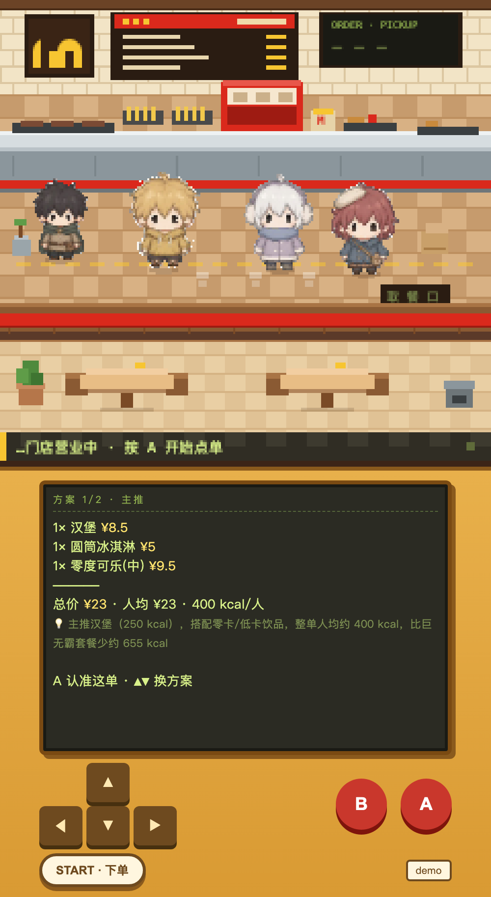
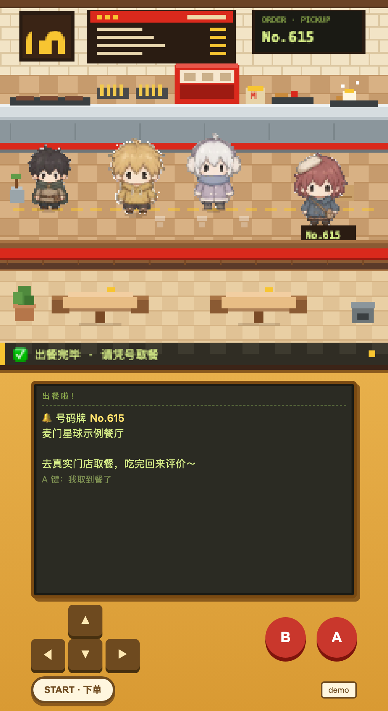
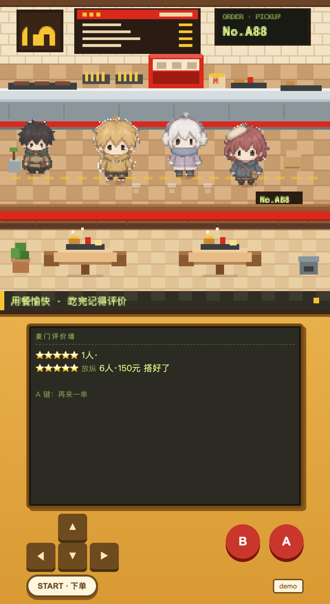

# 麦门星球 · 像素麦当劳点单游戏机

> 1024 超能 Coding 周末 · 用餐赛道 × 麦当劳程序员创意开发大赛

在一家像素风麦当劳里，跟 AI 店员「小麦」聊两句，它帮你点好最合适的一单——
**推荐有依据（真实菜单价格/热量），下单是真的（MCP 真实取餐号），备菜动画是真的跟着订单状态走。**

| 点单方案（LCD） | 出餐取号 | 评价墙 |
|---|---|---|
|  |  |  |

## 玩法（手机竖版，单手）

上半屏是备餐厅像素场景（星露谷风），下半屏是游戏机：LCD 屏显示对话，D-pad 选选项，A 确认，B 返回，START 一键下单。

1. **问答点单**：几个人 / 减脂还是放纵 / 尝新还是下午茶 / 忌口 / 预算
2. **AI 配餐**：主推 + 省钱版 + 丰盛版三套方案，每套有真实总价、人均、热量和推荐理由
3. **真实下单**：MCP 下单，拿到真实取餐号
4. **像素后厨**：四个员工小人接单、煎制（冒烟动画）、出餐，递给你**真实号码牌**
5. **用餐评价**：星级 + 标签 → 进入麦门评价墙

## 本地运行

```bash
node server/server.js          # 默认 3000 端口，demo 模式（无需 Token）
# 浏览器打开 http://localhost:3000
```

接真实麦当劳 MCP：

```bash
MCP_MODE=live MCP_ENDPOINT=<MCP端点> MCP_TOKEN=<你的token> node server/server.js
```

## 技术栈

- 纯 Node.js 后端（零依赖），单端口托管静态页面 + REST API
- MCP 适配层收敛在 `server/mcp.js` 一个文件，demo/live 双模式无缝切换
- 前端 Canvas 像素场景 + 状态机流程，无需任何前端框架

## 像素场景与角色素材

上半屏场景在 `web/scene.js`，一套 y 排序的 2.5D 像素厨房：墙面（金色拱门招牌 / 菜单板 / 出餐屏）、后厨台（煎区 / 炸区 / 饮料机 / 打包台）、取餐台、餐厅区。

- **员工**：小堡（煎区）、小薯（炸区）、小冰（饮料）、小麦（打包出餐）。订单状态一变，四个人会各自走到岗位、背对镜头操作，出餐时小麦端餐到取餐口。
- **素材管线**：`tools/staff-source.png`（4 角色 × 4 朝向的白底大图）→ `python3 tools/build-sprites.py` → `web/assets/staff.png`（4 列角色 × 4 行朝向，单格 37×51）。脚本做的是「边缘洪水填充去白底 → 连通域切图 → 整数倍缩到 44px 高 → 底部对齐进图集」，零第三方依赖（PNG 编解码在 `tools/pngtool.py` 里，纯标准库）。
- **改动作息 / 站位 / 台词**：只改 `web/scene.js` 里的 `staff` 数组和 `onStatus()`。
- **调试**：`http://localhost:3000/?state=preparing` 可强行把场景切到 idle / placed / preparing / ready / dining 任一状态，不用真下单。
- **演示节奏**：demo 模式默认 36 秒出餐，现场想更快/更慢用 `DEMO_READY_SECONDS=20` 调。

详见 [MCP_INTEGRATION.md](MCP_INTEGRATION.md) 与 [docs/PRODUCT.md](docs/PRODUCT.md)。
